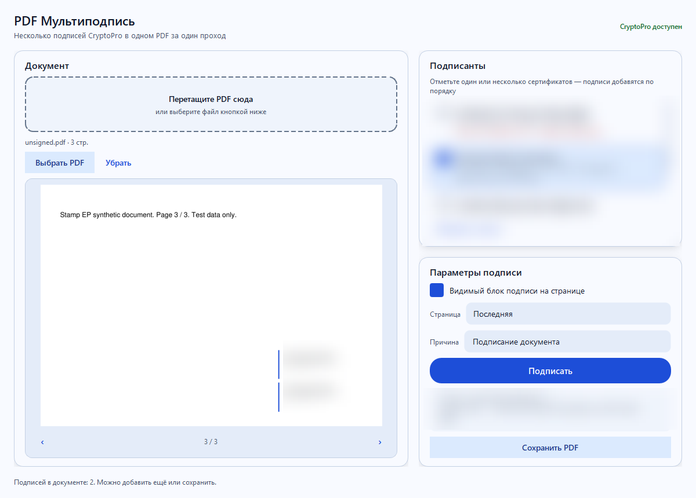
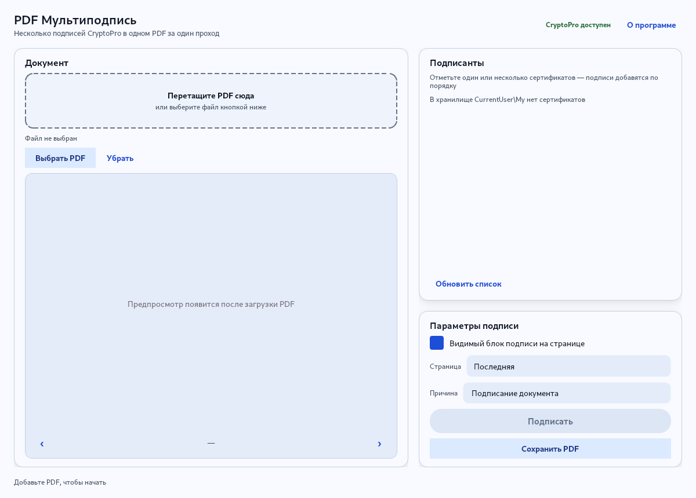
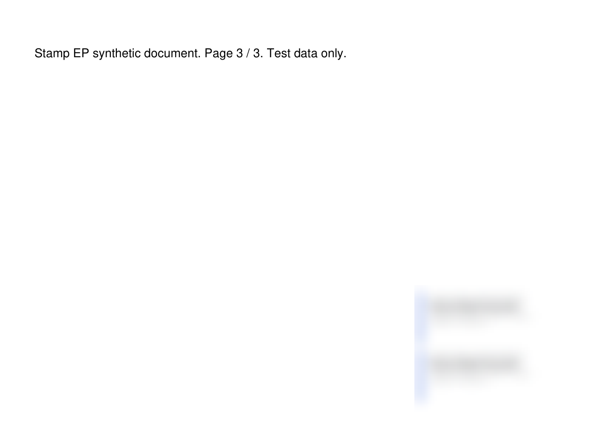

# PDF Мультиподпись

Простая настольная программа на PySide6 в стиле Material Design: подписывает PDF
**сразу несколькими подписями CryptoPro** за один проход — например, директор и
главный бухгалтер, или подпись организации и подпись контрагента.

Поддерживаются Windows 10/11 x64 и Linux x64 (проверено на Astra Linux 1.8.6).



## Скачать

Готовые сборки — в [GitHub Releases](https://github.com/Tripswarlock/pdf-multisign/releases):

- `PDF-Multisign.exe` — portable-сборка для Windows (один файл, Python не нужен);
- `pdf-multisign_1.0.0_amd64.deb` — пакет для Debian/Astra/Ubuntu.

## Установка

### Windows

1. Установите **CryptoPro CSP 5.0 R2+** с компонентом CAdES Browser Plug-in.
2. Установите сертификат в `CurrentUser\My`, проверьте: `certutil -user -store My`.
3. Запустите `PDF-Multisign.exe` — установка не требуется.

### Linux (Astra 1.8, Debian 12, Ubuntu 22.04+)

```bash
sudo apt install ./pdf-multisign_1.0.0_amd64.deb
pdf-multisign
```

Пакет ставит приложение в `/opt/pdf-multisign`, ярлык в меню и зависимости Python
внутри `/opt/pdf-multisign/vendor` — отдельно ставить PySide6 не нужно.
Нужен установленный CryptoPro CSP для Linux (`/opt/cprocsp/bin/*/cryptcp`,
`certmgr`) и сертификат в хранилище `uMy`:

```bash
/opt/cprocsp/bin/amd64/certmgr -list -store uMy
```

## Что делает


- открывает PDF (кнопка или перетаскивание), показывает предпросмотр страниц;
- показывает сертификаты из `CurrentUser\My` и честно помечает те, которыми
  подписать нельзя (ключ вне CryptoPro CSP, истёкший срок);
- добавляет по одной подписи на каждый отмеченный сертификат — за один проход,
  в один файл;
- по желанию рисует **видимый блок подписи** (ФИО, организация, срок действия
  сертификата, дата) или подписывает невидимо;
- после подписи проверяет результат: CryptoPro CSP + независимый ГОСТ-хеш
  (Streebog-256) по подписанным байтам;
- документ можно доподписывать повторно: каждая новая подпись добавляется как
  новая ревизия PDF, предыдущие остаются в файле;
- кнопка **«О программе»** — версия, автор, компоненты, состояние CryptoPro и
  напоминание о приватности (аналог раздела из «Штамп ЭП»).





## Запуск

```bat
run.cmd
```

или

```bat
set PYTHONPATH=%~dp0;%~dp0vendor;%~dp0vendor\win32;%~dp0vendor\win32\lib;%~dp0vendor\pywin32_system32
python -m pdfsign.app
```

Все зависимости лежат в `vendor/` (PySide6, PyMuPDF, pypdf, pywin32, asn1crypto,
gostcrypto), поэтому установка Python-пакетов не требуется. Исходные wheel-файлы
сохранены в `wheels/` — из них `vendor/` можно пересобрать на другой машине.

Требования:

1. Windows 10/11 x64.
2. **CryptoPro CSP 5.0 R2+** с компонентом CAdES Browser Plug-in.
3. Сертификат с закрытым ключом в `CurrentUser\My`, ключ — в контейнере CryptoPro
   (токен/рутокен или файловый контейнер). Проверка:
   ```powershell
   certutil -user -store My
   ```
4. Python 3.10+ (проверено на 3.14.2).

## Как устроена подпись

Подход взят из проекта `stamp-ep-sa-main` и доведён до рабочего приложения:

1. `CAdESCOM.Store.Open(CurrentUser, "My")` → поиск сертификата по SHA-1
   отпечатку;
2. `CAdESCOM.CPSigner` + `CAdESCOM.CadesSignedData.SignCades(signer, CADES_BES,
   detached=true)` — отсоединённая CAdES-BES, закрытый ключ не покидает CSP;
3. в PDF **дописывается новая ревизия** (incremental update): словарь подписи
   `/Type /Sig /SubFilter /adbe.pkcs7.detached` с `/ByteRange` и `/Contents`,
   sig-поле в `/AcroForm` и виджет-аннотация на странице с готовым appearance-
   потоком; старая часть файла остаётся байт-в-байт неизменной;
4. байты документа вне контейнера `/Contents` подписываются и CMS вставляется в
   заготовку;
5. следующая подпись — это ещё одна ревизия поверх предыдущей. Поэтому в файле
   оказывается несколько независимых подписей, а более ранняя подпись честно
   показывает «версия на момент подписания» — это нормальное поведение
   инкрементальных подписей.

### Важное исправление относительно прототипа

В исходном проекте `ContentEncoding` выставлялся **после** `Content`. CAdESCOM
преобразует значение в момент присваивания, поэтому подпись фактически считалась
по base64-тексту, закодированному в UTF-16LE, а не по байтам документа. Внутренняя
проверка CryptoPro такое принимает (она кодирует так же), но Adobe и другие
системы — нет.

Здесь `ContentEncoding` выставляется **до** `Content`, а после подписи выполняется
контрольная проверка: `messageDigest` из CMS обязан совпасть с Streebog-256
подписанных байтов. При несовпадении подпись не отдаётся пользователю
(`CMS_DIGEST_MISMATCH`).

## Ограничения

- **Только ключи CryptoPro.** Сертификаты с ключами в Microsoft Software Key
  Storage Provider (ECC/RSA) видны в списке, но недоступны для подписи — CAdESCOM
  с ними не работает. Программа помечает их и не даёт выбрать.
- **Просроченный сертификат** подписать нельзя — CryptoPro отказывает.
- **Цепочка доверия** не оценивается: программа подтверждает математическую
  верность подписи и совпадение хеша, но не юридический статус сертификата.
- **Отзыв (CRL/OCSP)** не проверяется — профиль полностью офлайновый.
- **Метка времени (TSA)** не ставится.
- **Шифрованные PDF** не поддерживаются.
- Ранняя подпись после добавления следующей показывает «документ изменён после
  подписи» — это ожидаемое поведение многоподписных PDF.
- Визуальный блок — векторный (контуры глифов), текст в нём не выделяется и не
  ищется поиском.

## Проверка

```bat
python tests\check_structure.py
```

Тест не требует токена: он подменяет криптопровайдер заглушкой и проверяет, что
две подписи добавляются, `/ByteRange` и `/Contents` корректны, а последняя
подпись покрывает актуальную ревизию файла.

Живая проверка на Windows (CryptoPro CSP 5.0, GOST R 34.10-2012):

- две подписи добавлены в один PDF и обе проверены (`VerifyCades` + ГОСТ-хеш);
- PDFium видит `FPDF_GetSignatureCount == 2`;
- подпись с отпечатком `B3717F61…` создаётся и проверяется, `messageDigest`
  совпадает с Streebog-256 документа.

Проверка на Astra Linux 1.8.6 (VirtualBox, CryptoPro CSP 5.0.13000):

- `.deb` устанавливается через `dpkg -i`, приложение запускается и рисует
  интерфейс (скриншот выше получен на Astra);
- `pdfsign.crypto` определяет `cryptcp` и `certmgr` в `/opt/cprocsp/bin/amd64`;
- CMS, созданная на Windows, проверяется на Linux: валидная — «верна»,
  изменённый документ — «не совпадает» (`tests/astra_verify_test.py`);
- пустое хранилище сертификатов обрабатывается как пустой список, а не ошибка.

## Сборка

```bash
# Windows exe (PyInstaller, ~71 МБ, один файл)
powershell -ExecutionPolicy Bypass -File packaging\windows\build_exe.ps1

# Linux .deb (собирается и на Windows, и на Linux)
python packaging\fetch_linux_vendor.py
python packaging\linux\build_deb.py --version 1.0.0 --out dist
```

## Структура

```
pdfsign/
  app.py          точка входа
  window.py       окно в Material Design
  theme.py        палитра и QSS
  about.py        диалог «О программе»
  crypto.py       CryptoPro: сертификаты, подпись, проверка (фасад по платформе)
  crypto_linux.py CryptoPro CSP для Linux через cryptcp/certmgr
  com.py          инициализация COM-апартамента (Windows)
  pdf.py          инкрементальная подпись PDF, AcroForm, ByteRange, парсинг
  appearance.py   видимый блок подписи (векторные контуры)
  service.py      сценарий «несколько подписей за один проход»
packaging/
  windows/        entry.py, build_exe.ps1, fetch_build_tools.py
  linux/          build_deb.py, guest_*.ps1 (тесты на VM), astra_install_test.sh
  make_icon.py    иконка приложения
tests/
  check_structure.py   офлайн-тест структуры PDF
  astra_smoke.py       headless-проверка интерфейса на целевой машине
docs/             скриншоты (Windows и Astra)
resources/        иконка PNG/ICO
```

## Лицензии

Код приложения — MIT. Qt/PySide6 — LGPL-3.0, PyMuPDF — AGPL-3.0 (используется
только для предпросмотра и рендера страниц), pypdf — BSD-3-Clause, pywin32 —
PSF, asn1crypto — MIT, gostcrypto — MIT. CryptoPro CSP не входит в поставку и
лицензируется отдельно.
